<h1 align="center">Guilherme Risson</h1>

 Software Engineering Student &middot; Backend &middot; Python, FastAPI, PostgreSQL

 
 
 

 <picture>
  <source media="(prefers-color-scheme: dark)" srcset="https://raw.githubusercontent.com/guilhermerissondev/guilhermerissondev/output/contributions-dark.svg" />
  
 </picture>

### Sobre

Estudo Engenharia de Software na Uninter e moro em Maringá (PR). Trabalho como Analista de Dados Pleno na Vitru Educação, onde desenvolvo em Python os sistemas do planejamento acadêmico da UniCesumar. Nos projetos pessoais, construo APIs com FastAPI e PostgreSQL.

**Experiência com projetos em Python**

- Otimizador de alocação docente em produção na Vitru (FastAPI, React, TypeScript, OR-Tools), que distribui cerca de 200 docentes em mais de 350 turmas por módulo em minutos, trabalho que levava semanas em planilha
- Job Hunters no ar, com FastAPI, SQLAlchemy, Alembic, PostgreSQL/pgvector e Next.js: cerca de 98 mil vagas de 649 fontes, 380 testes, CI no GitHub Actions e 21 ADRs
- Guia do Mercado, bot de Telegram com coletor em Python e banco PostgreSQL que estima o preço da lista de compras em 508 regiões do IBGE, a partir de cerca de 316 mil preços de 20 redes coletados toda semana
- Agente que publica 4 vídeos curtos por dia com fonte verificável para cada fato, coberto por 691 testes automatizados
- API em FastAPI que extrai com LLM os dados de editais do PNCP e só aceita valores que aparecem no PDF, com 61 testes offline no CI e custo de US$ 0,028 por edital
- Pipelines de dados em produção na Vitru, sobre bases de 1 milhão a mais de 40 milhões de linhas

### Projetos end-to-end

| Projeto | O que é | Stack |
|---|---|---|
| [Guia do Mercado](https://guilhermerissondev.github.io/guia-do-mercado/) · [código](https://github.com/guilhermerissondev/guia-do-mercado) | Bot de Telegram que monta a lista de compras com faixa de preço (econômico, típico, premium) e é compartilhada com quem vai ao mercado. 508 regiões, 20 redes, 94 itens | Python, TypeScript, PostgreSQL, Supabase |
| [Job Hunters](https://job-hunters-ebon.vercel.app) | SaaS de vagas em que cada indicação vem com a experiência do currículo que a justifica. ~98 mil vagas, 649 fontes, 380 testes, 21 ADRs | FastAPI, PostgreSQL/pgvector, Next.js, LLM |
| [Teacher Allocation Optimizer](https://github.com/guilhermerissondev/teacher-allocation-optimizer) | Sistema em produção na Vitru, com código aberto | FastAPI, React, TypeScript, CP-SAT |
| [TikTok Viral Generator](https://github.com/guilhermerissondev/tiktok-viral-generator) | Agentes que produzem vídeos curtos em pt-BR com fonte para cada fato. 691 testes | Python, Pydantic, SQLite, ffmpeg |

Outros projetos: [Procurement Triage Service](https://github.com/guilhermerissondev/procurement-triage-service) (extração de editais do PNCP com citação conferida no PDF) · [Regulatory RAG Eval](https://github.com/guilhermerissondev/regulatory-rag-eval) (busca híbrida sobre 294 normativos do BACEN, MRR de 0,361 para 0,644)

### Linguagens

<picture>
 <source media="(prefers-color-scheme: dark)" srcset="https://raw.githubusercontent.com/guilhermerissondev/guilhermerissondev/output/languages-dark.svg" />
 
</picture>

### Stack

**Backend:** Python &middot; FastAPI &middot; Pydantic &middot; SQLAlchemy &middot; Alembic &middot; pytest &middot; Docker &middot; GitHub Actions 
**Frontend:** TypeScript &middot; React &middot; Next.js &middot; Tailwind CSS 
**Dados:** PostgreSQL &middot; pgvector &middot; SQL Server &middot; SQLite &middot; DuckDB 
**IA:** LLM &middot; RAG &middot; Gemini API &middot; OR-Tools

---

Busco vaga júnior como desenvolvedor backend, remota ou em Maringá (PR). Currículo: <a href="https://guilhermerissondev.github.io/cv-guilherme-risson.pdf">PT</a> · <a href="https://guilhermerissondev.github.io/cv-guilherme-risson-en.pdf">EN</a>
